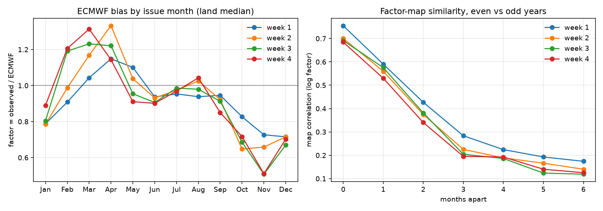

# Experiment 12 — does ECMWF's bias follow the season?

**Question.** Dyn++ (Exp 9) corrects a July forecast with a factor learned
from forecasts issued in June, July and August. That only makes sense if
ECMWF's rain bias changes slowly through the year, so that July looks like
June and August. Is that true, or is the month-to-month bias just noise?

No neural network and no training: this only looks at the Dyn++ factors and
scores Dyn++ itself. Runs in a few minutes on CPU.

```
python experiments/exp12_seasonal_bias_check/seasonal_bias.py
```

Outputs: `results/table.md`, `results/summary.json`, `results/seasonal_bias.png`.

## Background: what the factor is

For each grid cell, issue month and lead week (1–4):

```
factor = (average observed IMD weekly total + 1) / (average ECMWF weekly total + 1)
```

The averages run over the 2004–2017 forecasts in the window, and every
forecast is compared with the IMD rain on its own dates. Example: the
8 July 2010 forecast's week 3 (days 15–21, 23–29 July) is compared with IMD
rain for 23–29 July 2010. It is a ratio of averages, not an average of
per-forecast ratios, because one near-dry week would dominate the latter.
A factor above 1 means ECMWF is too dry there; below 1, too wet.

With a ±1-month window, the July factor pools the June, July and August
issues of 2004–2017: about 13 forecasts a year × 14 years ≈ 180. July alone
would give only about 60, which is a noisier average.

## How it was checked

1. **Seasonal cycle.** Fit factors on one issue month at a time and take the
   median over Indian land cells.
2. **Pattern or noise?** Fit single-month factor maps separately on the
   even years and the odd years. Then correlate month *m* (even years) with
   month *m + k* (odd years) over land. The two halves share no forecasts, so
   a high correlation cannot come from reusing the same data.
   - Gap 0 (same month, independent years) is the ceiling: the most alike two
     samples can look given the noise.
   - If the bias follows the season, similarity falls gradually with the gap.
     If it were noise, a 1-month gap would already be as low as a 6-month gap.
3. **Window width.** Score Dyn++ fitted with windows of same month only,
   ±1 (what we use), ±2, ±3 months and the whole year. Validation years
   (2018–20) decide; test (2021–23) is shown for reference.

## Results



### 1. The bias has a clear seasonal cycle

Land-median factor, all 2004–2017 years:

| issue month | wk1 | wk2 | wk3 | wk4 |
|---|---|---|---|---|
| Jan | 0.79 | 0.78 | 0.80 | 0.89 |
| Feb | 0.91 | 0.99 | 1.19 | 1.21 |
| Mar | 1.04 | 1.17 | 1.23 | 1.31 |
| Apr | 1.15 | 1.33 | 1.22 | 1.14 |
| May | 1.10 | 1.04 | 0.95 | 0.91 |
| Jun | 0.94 | 0.93 | 0.91 | 0.90 |
| Jul | 0.95 | 0.97 | 0.99 | 0.97 |
| Aug | 0.94 | 1.03 | 0.98 | 1.04 |
| Sep | 0.95 | 0.92 | 0.91 | 0.85 |
| Oct | 0.83 | 0.65 | 0.69 | 0.72 |
| Nov | 0.73 | 0.66 | 0.51 | 0.51 |
| Dec | 0.72 | 0.72 | 0.67 | 0.70 |

- ECMWF is **too dry before the monsoon** (Feb–Apr, factor up to 1.3).
- It is roughly right **on average during the monsoon** (Jun–Sep, about 0.9–1.0).
  The land median hides large regional errors, which the maps keep.
- It is **too wet after the monsoon** (Oct–Dec, as low as 0.5 in November).
- Neighbouring months have similar values, and the changes are gradual.

### 2. It is a pattern, not noise

Correlation of factor maps, even years vs odd years (log factor, Indian land
cells). Mean over all 12 months, with June–September in brackets:

| months apart | wk1 | wk2 | wk3 | wk4 |
|---|---|---|---|---|
| 0 (ceiling) | 0.75 (0.83) | 0.70 (0.82) | 0.69 (0.78) | 0.68 (0.71) |
| 1 | 0.59 (0.64) | 0.56 (0.57) | 0.58 (0.58) | 0.53 (0.60) |
| 2 | 0.43 (0.48) | 0.37 (0.43) | 0.38 (0.38) | 0.34 (0.42) |
| 3 | 0.28 (0.29) | 0.23 (0.22) | 0.20 (0.15) | 0.20 (0.20) |
| 6 | 0.17 (0.16) | 0.14 (0.10) | 0.12 (0.09) | 0.13 (0.12) |

- **One month apart**, the bias maps keep about 80% of the same-month
  similarity (0.53–0.59 vs 0.68–0.75).
- Similarity then falls **smoothly** with the gap, down to about 0.13 at six
  months.
- Noise would not decay like this. Neighbouring months share most of their
  bias pattern; months half a year apart share little.

### 3. ±1 month is a sensible window; wider is worse

Dyn++ weekly anomaly correlation, cell (wk1–4) and all-India (wk1–4):

**Validation, 2018–2020 (155 forecasts):**

| window | cell wk1 | wk2 | wk3 | wk4 | all-India wk1 | wk2 | wk3 | wk4 |
|---|---|---|---|---|---|---|---|---|
| same month only | 0.641 | 0.455 | 0.227 | **0.190** | **0.921** | **0.715** | **0.582** | **0.322** |
| **±1 month (used)** | **0.648** | **0.457** | **0.231** | 0.183 | 0.907 | 0.673 | 0.576 | 0.313 |
| ±2 months | 0.636 | 0.439 | 0.219 | 0.169 | 0.892 | 0.637 | 0.547 | 0.272 |
| ±3 months | 0.627 | 0.431 | 0.213 | 0.162 | 0.885 | 0.630 | 0.537 | 0.261 |
| all year | 0.619 | 0.423 | 0.200 | 0.150 | 0.878 | 0.633 | 0.536 | 0.270 |

**Test, 2021–2023 (153 forecasts), for reference:**

| window | cell wk1 | wk2 | wk3 | wk4 | all-India wk1 | wk2 | wk3 | wk4 |
|---|---|---|---|---|---|---|---|---|
| same month only | 0.667 | 0.509 | **0.335** | **0.249** | **0.916** | **0.838** | 0.578 | 0.381 |
| **±1 month (used)** | **0.668** | **0.512** | 0.330 | 0.239 | 0.910 | 0.837 | **0.590** | 0.389 |
| ±2 months | 0.663 | 0.499 | 0.315 | 0.233 | 0.907 | 0.824 | 0.580 | **0.412** |
| ±3 months | 0.656 | 0.492 | 0.307 | 0.221 | 0.902 | 0.817 | 0.576 | 0.400 |
| all year | 0.647 | 0.480 | 0.300 | 0.212 | 0.889 | 0.807 | 0.576 | 0.405 |

- **Per cell, same-month and ±1 month tie** (differences ≤0.01). Every wider
  window is steadily worse, down to −0.03/−0.04 for a single all-year factor.
  This matches part 2: pooling distant months mixes in a different bias.
- **On the all-India score, same-month is a little ahead on validation**
  (e.g. week 2: 0.715 vs 0.673). On test the two are tied. All-India
  correlation over 3 years is noisy, so this is not a reliable difference.
- No bootstrap was run here. The cell-level gaps between same-month and
  ±1 month are well inside the date-sampling noise seen elsewhere (±0.02).

## What it means

1. **The assumption behind Dyn++'s window holds.** ECMWF's bias over India
   follows the season: it is too dry before the monsoon, roughly right on
   average during it, and too wet after it. Neighbouring months' bias maps
   are much more alike than distant months'.
2. **±1 month is a reasonable choice**, and we keep it. It ties with
   same-month factors and is clearly better than wider windows. The pooling
   triples the sample, which matters more when fewer years are available
   (e.g. the past-only fits in Exp 11).
3. Same-month factors are a reasonable alternative, and slightly better on
   the all-India score on validation. It's not worth switching on this
   evidence.

## Caveats

- **Land medians hide regional detail.** Part 1 summarises a whole map with
  one number. Part 2 is the map-level check.
- **Single-month maps from 7 years** (even or odd) are noisy, which is why the
  gap-0 ceiling is 0.7–0.8 rather than 1.
- **Three validation years.** The window comparison is a sanity check, not a
  tuned choice.
